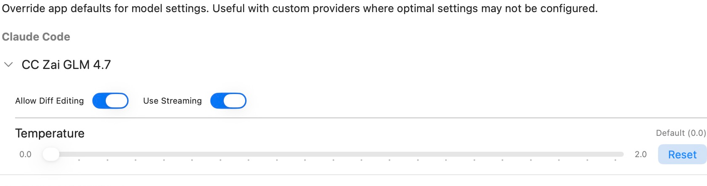

Configure per-model streaming, API routing, and temperature overrides. These settings are especially useful when a custom endpoint needs behavior different from the app's defaults.

Open **Settings → Models & Providers → Model Config**. Available models are grouped by provider and sorted by name. Expand a model to see its controls. If a model is missing, configure its provider and model availability in [API Providers](./api-providers.mdx), [OpenRouter](./openrouter.mdx), or [Custom API](./custom-api.mdx).

Changes are saved automatically as app-wide overrides keyed to the model's identifier. There is no separate Save button. Models with saved overrides display a sliders icon and expand automatically when you open the page.

For model discovery, identifiers, capabilities, effort, and tiers, use the shared [Models reference](../../providers/models.mdx). This page documents the per-model settings controls.

## Allow Diff Editing

This switch remains in the interface and saves a per-model preference, but the current implementation treats every model as capable of diff editing. The saved switch does **not** disable diff eligibility or force whole-file responses.

To choose **Diff**, **Whole**, or **None** for built-in chat, use [Chat Settings → Advanced Chat Controls](../prompting/chat-settings.mdx#advanced-chat-controls-edit-mode). That response-format choice is separate from this legacy capability switch.

## Use Streaming

Controls whether a supported provider request streams its response as it arrives or returns the completed response together. Turn it off for a model or endpoint that does not support streaming reliably.

The saved override is consulted by provider paths that use the model's streaming capability. It cannot make an endpoint support a streaming protocol it does not implement. Built-in model defaults can differ, so the switch is not a universal guarantee of the request mode used by every provider.

## Use Responses-API

This switch appears only for custom-provider models. It controls the model's API-routing flag for the **Responses API**, rather than the usual Chat Completions route. Enable it only when the custom endpoint supports that API.

Without a saved override, custom-provider models default to not using the Responses API. Built-in models choose their API route through the app's model definitions and do not show this switch.

This setting does not change the provider URL, credentials, or available model list. Configure those on [Custom API](./custom-api.mdx).

## Temperature

The per-model slider ranges from **0.0 to 2.0** in **0.1** steps. Moving it creates an explicit temperature override for that model. An explicit **0.0** is still an override; it is not the same as removing the setting.

**Reset** removes only the temperature override. The row then displays **Default**, using the model's default temperature when one exists, or the global temperature for its slider display.

For provider requests that use the shared temperature settings, precedence is:

1. An explicit per-model temperature override.
2. The request's global temperature, when nonzero.
3. The model's built-in default, or omission of the parameter if no default exists.

The displayed fallback and the eventual request value can therefore differ when a nonzero global temperature is set. Provider implementations can also omit temperature for models that do not support it. Temperature is not a reasoning-effort control.

## Token limits and other settings

Model Config has no context-window or maximum-output-token control in the current implementation. Set custom-provider output limits on [Custom API](./custom-api.mdx#default-output-max-tokens), or use the provider-specific options in [OpenRouter](./openrouter.mdx#advanced-configuration).

**Reset** beside Temperature does not clear streaming, Responses API, or diff preferences. Those switches save explicit on/off values independently. CLI-agent model and reasoning-effort choices are configured in [Agent Models](../agent-mode/agent-models.mdx).
