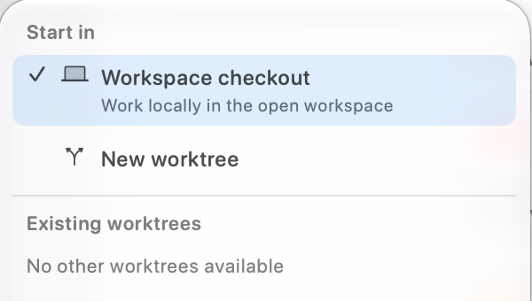

A worktree gives a coding task its own checkout. Before starting, open the intended Git repository and decide which committed starting point the task needs. A new worktree does not copy your main checkout's uncommitted tracked edits.

## Start a task in a new worktree

1. Open a new session and choose **Work locally** above the message editor.
2. Under **Start in**, select **New worktree**. This stages the choice; creation happens when you first send.
3. Write a focused task with an observable result. For example: “Fix the empty-state layout and verify it at narrow widths. Work in the new worktree; leave the main checkout unchanged.”
4. Send, then inspect the execution-location indicator. Check the path and branch or detached commit before assuming that work is isolated. If creation reports an error, resolve it before asking for edits.



For a particular base revision or branch configuration, use the supported creation options exposed by the [manage_worktree tool](../mcp-server/mcp-tools.mdx#manage_worktree), and inspect the returned descriptor. Do not infer the base from the task's name.

## Continue in an existing worktree

Choose an entry under **Existing worktrees**. Rows identify the branch or detached commit, worktree name, and path. A prunable entry is unavailable. “No other worktrees available” means the picker has no alternative checkout to offer; it does not create one automatically.

Changing an established session's location restarts its provider context and can require stopping an active turn. Follow [Execution Location](../agent-mode/execution-location.mdx#change-an-existing-sessions-location) before moving an ongoing task.

## Prepare local setup

Committed files come from Git. Dependencies, local configuration, and development services may need separate preparation. To copy selected ignored setup files into app-managed worktrees, put narrow patterns in `.worktreeinclude` at the main repository root:

```gitignore
# Copy only these files if Git already ignores them.
.env.local
config/development.json
```

The include file does not make a file ignored. Add the appropriate ignore rules separately if needed. Automatic session creation uses the ignored-only default; see [copying rules and exclusions](./overview.mdx#copying-local-ignored-files-with-worktreeinclude) for the MCP untracked-file opt-in and external-path limitations.

## Finish and preserve the result

Run the project's relevant checks in the task's checkout and inspect the actual changes. Commit the intended source changes before requesting a RepoPrompt worktree merge. Stopping a coding agent, closing a conversation, or retiring an overseer lane does not merge its work.

Keep the checkout until its work is integrated or deliberately preserved elsewhere. Unbinding a session is a routing change, not worktree deletion. Continue with [Review and Merge](./review-and-merge.mdx).
