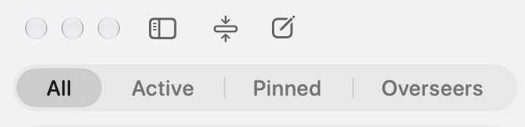
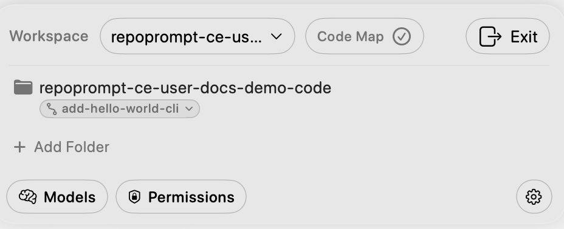
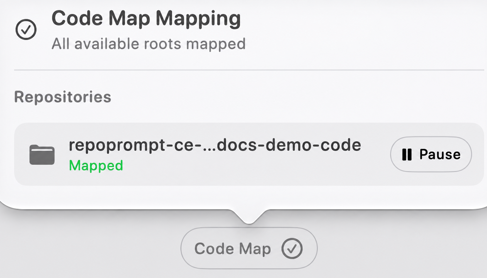
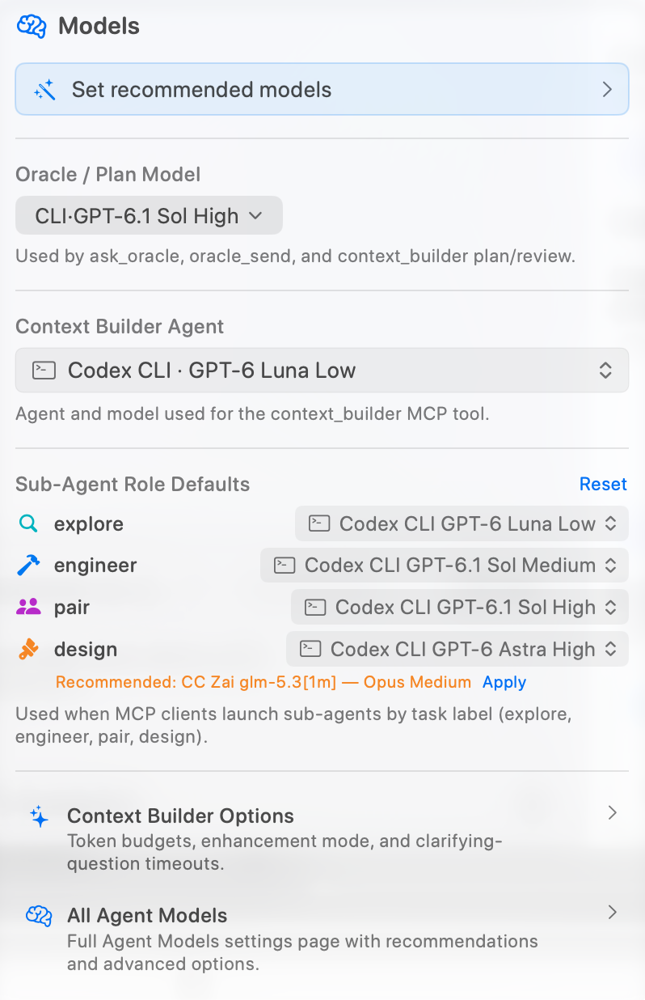
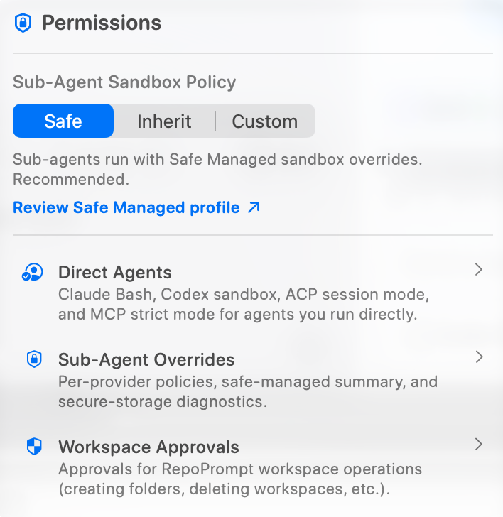

The Agent sidebar helps you start a conversation and find sessions in the current workspace. Its controls sit above the session list.

## New Session

Select the **New Session** button, shown as a square with a pencil, to open a new Agent chat. Choose a workflow if you want one, then enter and send your task in the message editor.

## Hide Sidebar

Select **Hide Sidebar** to give the conversation more room. Use the sidebar control again to show it, or use the configurable **Toggle session sidebar** shortcut, **Option+Command+B** by default.

## Collapse all sub-agent threads

Select **Collapse all sub-agent threads** to close the expanded child-session groups in the sidebar. This changes the list view; it does not stop or delete the sessions. Expand a parent row to see its children again.

## Session filters

Use the filters above the search field to choose which sessions to show:

- **All** shows every session in the current workspace.
- **Active** shows sessions running now, waiting for you, or failed while you were away.
- **Pinned** shows sessions you pinned.
- **Overseers** groups sessions that oversee other sessions with the sessions they oversee.

Search the session list by entering text in **Search sessions**.

## Session History

Below the filters and search field, the sidebar lists your sessions. Select one to return to its conversation; session groups and status indicators help you find work and see what needs attention. See [Session History](./session-history.mdx) for browsing, organizing, and recovering sessions.

## Workspace

The workspace panel below the session list shows the current workspace and its folders.

### Switch workspace

Select the workspace name to open **Switch workspace** and choose a workspace or manage workspaces. The folder list updates to reflect the selected workspace. See [Manage Workspaces](../settings/workspaces/manage-workspaces.mdx).

### Code Map status

Select **Code Map** to see the mapping summary and status for each root. While indexing, the panel can show progress. Where available, use **Pause**, **Resume**, or **Retry** for a root. See [Code Maps settings](../settings/general/advanced.mdx#code-maps) for global controls.

### Folders

Each row identifies a workspace root. Git roots can show their branch or worktree context; the current session's worktree binding may also appear. Use **Add Folder** to add another root. Folder controls can include reordering and removal. See [Worktrees](../worktrees/overview.mdx) for session bindings.

### Models

Select **Models** to open quick model settings. You can review recommendations, choose the Oracle or plan model and Context Builder agent, and set defaults for the explore, engineer, pair, and design sub-agent roles. The popover also links to Context Builder options and the full Agent Models settings. Available choices depend on your configured providers; see [Providers & Models](../providers/overview.mdx).

### Permissions

Select **Permissions** to choose the global sub-agent sandbox policy: **Safe** applies Safe Managed overrides, **Inherit** uses provider permissions, and **Custom** uses per-provider modes. The popover links to the policy details, direct-agent permissions, sub-agent overrides, and workspace approvals. See [Agent Permissions](../settings/agent-mode/agent-permissions.mdx) and [Workspace Approvals](../settings/mcp-server/workspace-approvals.mdx).

### Settings

Select the gear icon to open **Agent Mode Overview** in Settings, where you can navigate to the full settings pages.

### Exit workspace

Select **Exit** to leave the current workspace. The control may be unavailable while an exit cannot be performed.

