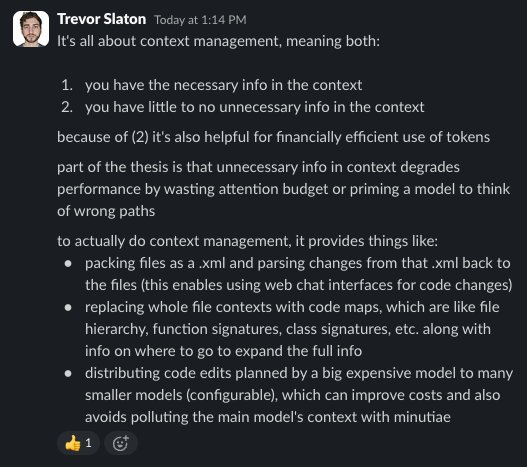

[Watch the What Is Repo Prompt video walkthrough](https://youtu.be/ncY6cqOCd_Y?si=xODzv6OePJYZp_si)

RepoPrompt is built to make your AI prompts laser-focused by grounding them in the most relevant files from your project. Instead of guessing what to include, you assemble rich, accurate context in just a few clicks.

Use the Context Builder or the MCP Discover preset to automatically surface the files that matter. Let an AI model scan your codebase, understand the task, and curate the exact snippets the assistant needs—no more manual hunting around.

Once the context is ready, RepoPrompt Chat delivers surgically precise edits. Keep full control as you review every change, or hand the wheel to your agent to drive longer workflows with industry-leading results.

Want to see the anatomy of a great prompt? Explore the [visual prompt assembly demo](/) for a guided breakdown.

## Rapid Iteration

Because of Repo Prompt's efficient use of context, you can also use it to rapidly iterate on code using it's efficient XML Editing workflows. See how you can get complex multi file edits handled in seconds, with a tool that respects your time.

[Watch the What Is Repo Prompt video walkthrough](https://youtu.be/LSQBi0Vx3Y4?si=iETS1YjzndhrRezy)

## Agent Orientation

Every new agent session is like on-boarding a new hire into your codebase.

Effective orientation can make all the difference because the initial tokens in a context window are so important to getting good results. Use Repo Prompt to kickstart every new session with the right context around your task to get better results faster.

[Watch the What Is Repo Prompt video walkthrough](https://youtu.be/9tQijoWr-QM?si=ineT5WUNc65SvEIj)

If that explanation doesn't cut it for you, see what Trevor (Gauntlet AI cohort 2 Alumn) has to say about it:

