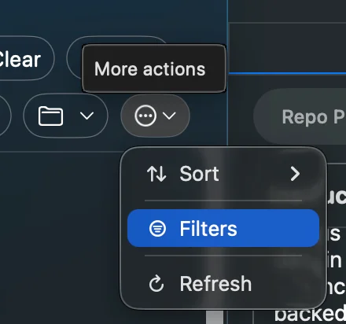
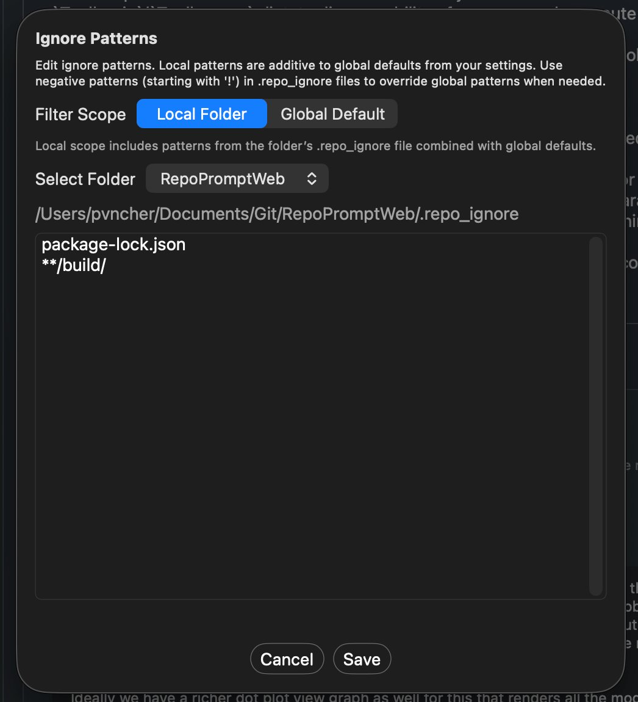
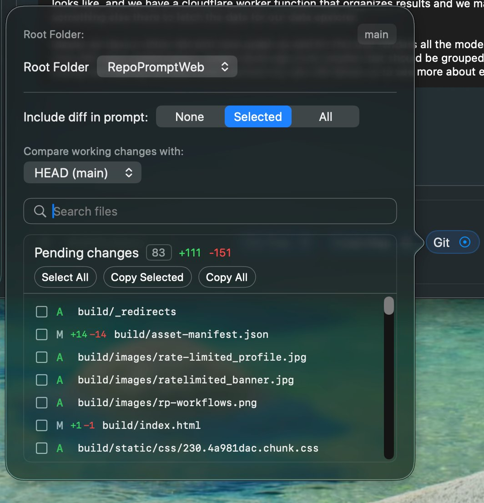

Every file can be included in one of three modes, giving you fine-grained control over token usage.

## Selection Modes

| Mode | What's Included | Token Impact | Best For |
| --- | --- | --- | --- |
| **Full** | Complete file content | Highest | Files you're actively editing |
| **Slices** | Specific line ranges | Medium | Large files where only part matters |
| **Codemap** | Function/type signatures only | Lowest (~10x smaller) | Reference files, APIs, dependencies |

## Switching Modes

- **Click** a file to select it (Full mode by default)
- **Right-click** for mode options: show as Full or Codemap ("Show as API only")
- Files marked with `+` in the tree have codemaps available

## Selected Files Panel

The selected files panel shows your current selection with token counts. Use the controls to manage your context:

- **Sort:** Order by Name (A-Z, Z-A) or Tokens (Low-High, High-Low)
- **Gear menu:** View Mode, Collapse All Folders, Clear All Line Slices, Clear File Selection
- **Per-file actions:** Right-click to switch modes or clear slices on individual files

## Using Slices

Slices let you include only specific line ranges from a file. Slices are created through MCP-connected agents:

- **Context Builder:** Automatically creates slices when curating context—it reads files and extracts only the relevant sections to fit your token budget
- **MCP Agents:** Any agent connected via MCP can use the `manage_selection` tool to create slices with specific line ranges and descriptions

When a file has slices, you'll see the line range (e.g., "L1-107") and a scissors icon. You can clear slices via right-click or the gear menu's "Clear All Line Slices" option.

:::tip

**Slice Power:** Context Builder can turn a 2000-line file into a 50-line slice containing just the relevant function—massive token savings while preserving the context AI needs.

:::

## File Tree Options

The file tree helps AI understand your project structure and navigate relationships between files.

| Option | What It Shows | Tokens |
| --- | --- | --- |
| **Auto** | Balanced tree, trimmed if needed | Low-Medium |
| **Full** | Complete directory structure | Higher |
| **Selected** | Only selected files and parents | Lowest |
| **None** | No file tree | Zero |

Files with available codemaps show a `+` marker in the tree. This helps AI know which files have structural information available.

## File Filtering

Repo Prompt respects your `.gitignore` files automatically. If files are missing from the tree, they may be filtered out. Access filter settings via the filter icon in the file tree toolbar.

**Filter options:**

- **Local ignore file:** Create workspace-specific ignore patterns via the UI
- **Global ignores:** Set patterns that apply to all workspaces
- **Negative patterns:** Use `!` prefix to counter gitignore patterns you need to override (e.g., `!dist/important.js`)

:::tip

**Tip:** If a file you need isn't showing up, check your gitignore patterns and use negative patterns to override them.

:::

## Git Integration

Include diffs of changed files in your prompt. Access git controls via the "Git" button in the bottom bar.

**Git controls:**

- **Compare with:** Select which branch or tag to diff against (HEAD, main, etc.)
- **Include diff in prompt:** None, Selected files only, or All changed files
- **Pending changes:** View all modified files with line counts (+/-)
- **Select files:** Check files to include their diffs in context

Both Compose and Chat have separate git settings. The **Review** and **Diff Follow-up** presets auto-configure this to include diffs for selected files.

:::tip

**Tip:** Use git diffs to give AI context about recent changes when debugging issues or continuing work on a feature.

:::
