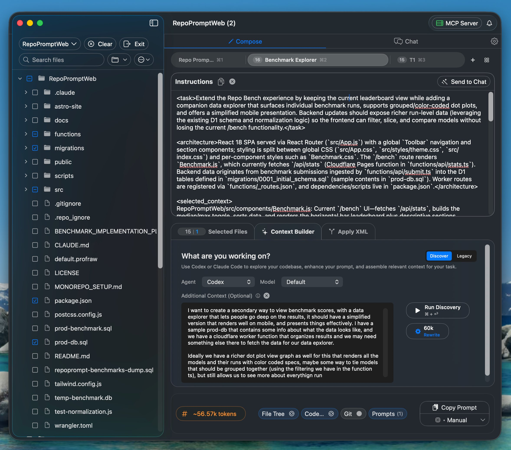
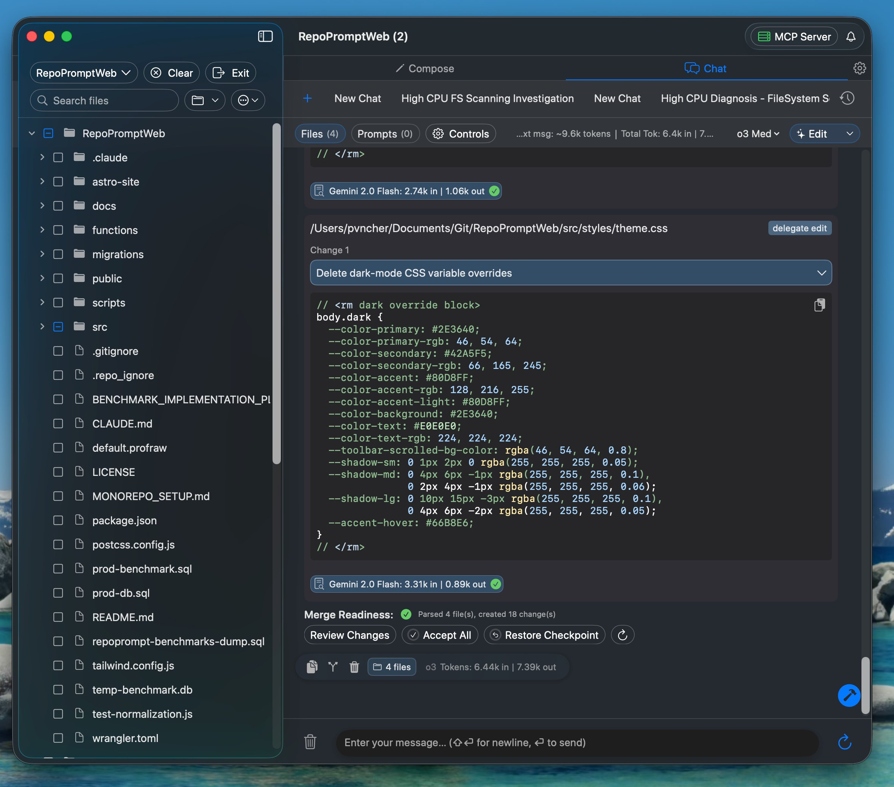
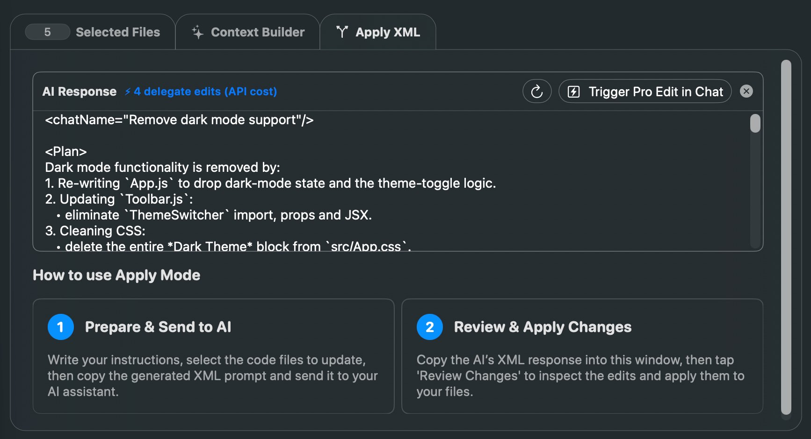
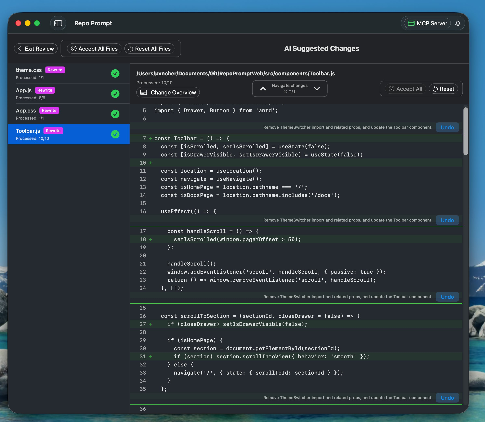

RepoPrompt's interface is designed around three main views: Compose, Chat, and Apply. Here's how they work together.

## Main Views

### Compose View

The primary workspace where you build context and craft prompts.

**Key elements:**

- **File Tree (left):** Browse and select files from your workspace
- **Selected Files Panel:** View and manage your current selection
- **Instructions Area:** Write your prompt/task description
- **Bottom Bar:** Copy presets, token count, Copy and Chat buttons

### Chat View

Have AI conversations with your code context automatically included.

**Key elements:**

- **Message Thread:** Conversation history with AI responses
- **Input Bar:** Send messages, toggle Pro Edit mode
- **Model Selector:** Choose which AI model to use
- **Chat History Tabs:** Switch between conversation sessions

### Apply View

Review and apply code changes from AI responses. Paste Pro Edit XML or use the built-in chat to generate changes.

**Key elements:**

- **Paste Area:** Paste AI responses containing code changes
- **Process Button:** Parse XML and send to chat for parallel edits

### Review View

After processing, review each file's changes before applying.

**Key elements:**

- **File Cards:** Each modified file shown with change preview
- **Diff View:** Line-by-line comparison of changes
- **Apply Controls:** Apply all, apply selected, or reject changes

## Navigation

### Tab Bar

Switch between views using the tab bar at the top:

- **Compose tabs:** Multiple compose sessions (like browser tabs)
- **Chat:** Access the chat interface
- **Apply:** Review pending changes

### Toolbar

Quick access to common actions:

- **Settings (gear icon):** Open preferences
- **New Tab:** Create a new compose tab
- **Search:** Find files in your workspace

## Compose View Details

### File Selection Panel

The left sidebar shows your workspace files:

- **Click** a file to select it (adds to context)
- **Right-click** for options: Full, Slices, Codemap modes
- **Search** to filter files by name
- Files with `+` marker have codemaps available

### Instructions Area

Where you write your prompt:

- **Prompt dropdown:** Access saved prompts
- **System prompt toggle:** Include/exclude system instructions
- **Edit mode toggle:** Enable Pro Edit XML format

### Bottom Bar

The control center for your prompt:

- **Copy Preset dropdown:** Choose format (Standard, Pro Edit, Plan, etc.)
- **Token counter:** Shows current context size
- **Copy button:** Copy prompt to clipboard
- **New Chat button:** Send directly to Chat view

:::tip

**Keyboard Shortcuts:** `⌘+C` to copy, `⌘+N` for new chat, `⌘+F` to search files, `⌘+,` for settings.

:::
