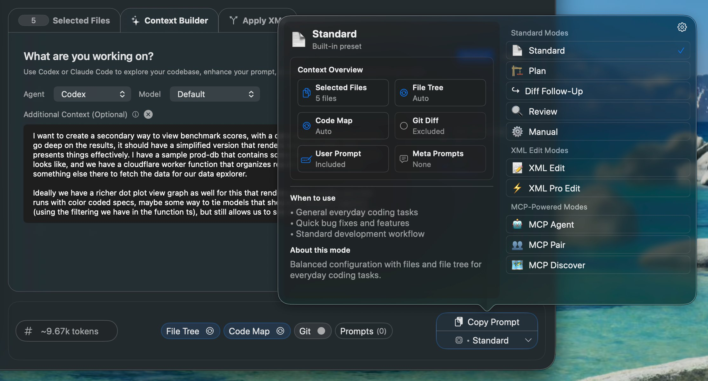
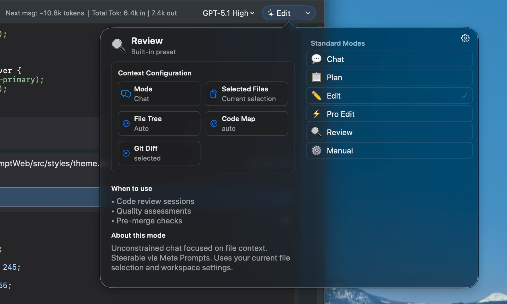
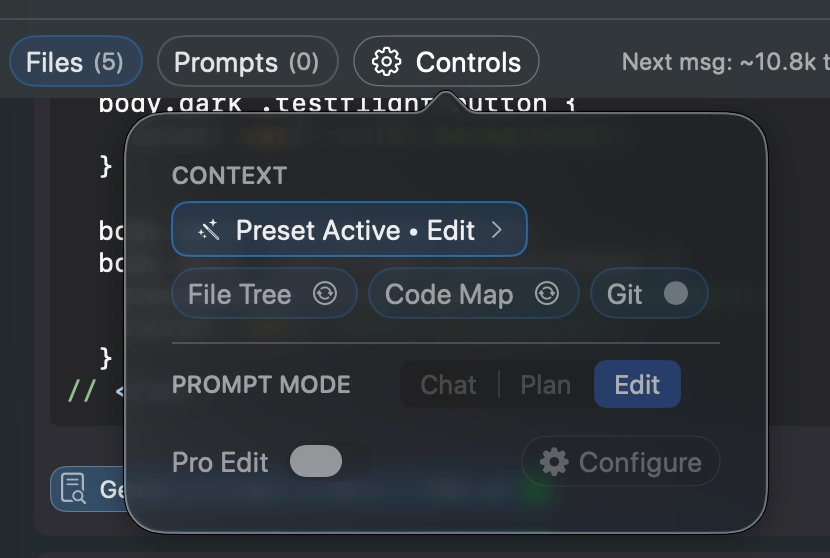
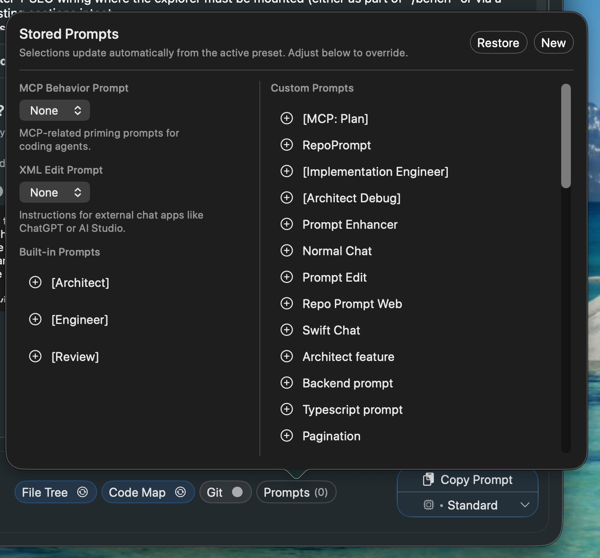

Presets save and restore your complete context configuration - file selection, prompt, and app settings - in one click.

## Copy Presets vs Chat Presets

Both copy and chat have their own preset dropdowns. Presets customize the system prompt, file tree inclusion, git diffs, and codemap settings.

Copy Presets

Chat Presets

## Manual Controls

Select "Manual" from either preset dropdown to configure each setting individually:

## What Presets Configure

- **System prompt:** Instructions that guide AI behavior
- **File tree:** Include project structure (Auto, Full, Selected, None)
- **Git diffs:** Include uncommitted changes
- **Codemaps:** Include API signatures for unselected files

## Built-in Presets

| Preset | Purpose |
| --- | --- |
| **Standard** | Clean formatting for any AI (ChatGPT, Claude, etc.) |
| **XML Edit** | XML format for structured changes - paste response back to apply |
| **Plan** | Optimized for architectural planning and design discussions |
| **Diff Follow-up** | Include diffs of changed files for review in ongoing chats |

## MCP Copy Presets

When handing off to external agents (Claude Code, Codex), MCP presets prepare the agent:

| Preset | Purpose |
| --- | --- |
| **MCP Pair** | Pair programming workflow—agent drives, chat implements |
| **MCP Discover** | Same as Context Builder—agent explores and curates context |
| **MCP Agent** | Primes agent on MCP tooling for autonomous work |

## Creating Custom Presets

1. Configure your selection, prompt, and settings
2. Click the preset dropdown → "Save as Preset"
3. Name your preset descriptively
4. Access it anytime from the preset menu

## Preset Use Cases

- **Feature work:** Preset with relevant files for a specific feature
- **Code review:** Preset with review-focused prompt and diff settings
- **Debugging:** Preset with error handling code and logging utilities
- **Documentation:** Preset with doc-writing prompt and public APIs

## Stored Prompts

Stored prompts are reusable instruction snippets that power both presets and custom workflows. Access via the "Prompts" button in the bottom bar.

### Built-in Prompt Categories

- **Architect/Engineer/Review:** Role-based prompts used by the Plan preset for architectural discussions
- **MCP Behavior Prompts:** Prime external agents for MCP Discover, Pair, and Agent workflows
- **XML Edit Prompts:** Control response format—Diff (minimal changes), Whole (full file), Pro (parallel edits). Used by Edit and Pro Edit modes in chat

### Custom Prompts

Create your own stored prompts for frequently-used instructions:

1. Click "New" in the stored prompts panel
2. Write your instruction text
3. Name it descriptively (e.g., "Code Review Guidelines")
4. Click + to insert into your current prompt

:::tip

**Tip:** Combine multiple stored prompts by clicking + on each one. Use stored prompts for reusable instructions and presets for complete workflow configurations.

:::
