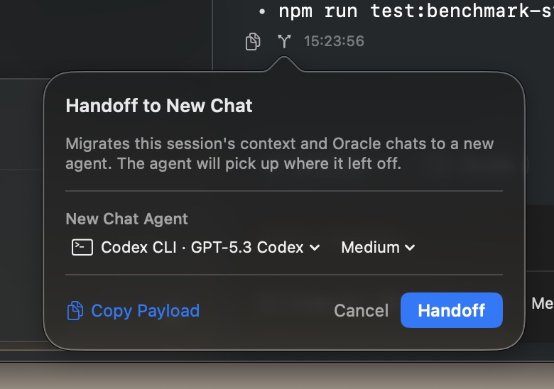

## About this archive

This archive preserves the Classic documentation and historical guides, including older material no longer linked from the source navigation. Commands, model recommendations, prices, limits, and feature descriptions reflect the source rather than a newly verified current specification. For CE installation and agent workflows, start with [RepoPrompt CE 1.5.0](../version-1.5.0/index.mdx).

:::note Version history

All Classic changelogs are retained here. The CE Version 1 changelog belongs to the [1.5.0 documentation](../version-1.5.0/changelog/ce-version-1-0.mdx).

:::

## Documentation table of contents

### MCP Server

- [Overview](./mcp-server/mcp-overview.mdx)
- [Setup Guide](./mcp-server/mcp-setup.mdx)
- [Tools Reference](./mcp-server/mcp-tools.mdx)
- [App Settings Tool](./mcp-server/mcp-app-settings.mdx)
- [Transport Modes](./mcp-server/mcp-transport.mdx)
- [Settings & Presets](./mcp-server/mcp-settings.mdx)
- [Connection Management](./mcp-server/mcp-connections.mdx)
- [Workflow Commands](./mcp-server/workflow-commands.mdx)

### Workflows

- [Context Over Convenience](./workflows/overview.mdx)
- [Discovery (Context Builder)](./workflows/discovery.mdx)
- [Architectural Planning](./workflows/architectural-planning.mdx)
- [MCP Builder Workflow](./workflows/mcp-builder.mdx)
- [Orchestration](./workflows/pair-programming.mdx)
- [Model Recommendations](./workflows/model-recommendations.mdx)

### AI Providers

- [API Providers](./ai-providers/api-providers.mdx)
- [CLI Providers](./ai-providers/cli-providers.mdx)
- [OpenRouter](./ai-providers/openrouter.mdx)
- [Custom Providers](./ai-providers/custom-providers.mdx)

### Code Reviews

- [Code Reviews & Git](./code-reviews/overview.mdx)

### rp-cli

- [Command Line Guide](./rp-cli/cli-guide.mdx)
- [App Settings from the CLI](./rp-cli/cli-app-settings.mdx)

### Reference

- [Keyboard Shortcuts](./reference/shortcuts.mdx)

### IDE Mode (Classic Edition)

- [Overview](./ide-mode/overview.mdx)
- [Workflows](./ide-mode/workflows.mdx)
- [Context Overview](./ide-mode/context-overview.mdx)
- [Interface Overview](./ide-mode/interface.mdx)
- [File Selection](./ide-mode/file-selection.mdx)
- [First Prompt](./ide-mode/first-prompt.mdx)
- [Codemaps](./ide-mode/codemaps.mdx)
- [Token Management](./ide-mode/tokens.mdx)
- [Presets & Prompts](./ide-mode/presets.mdx)

### Changelog

- [Classic Version 2.1](./changelog/version-2-1.mdx)
- [Classic Version 2.0](./changelog/version-2-0.mdx)
- [Classic Version 1.6](./changelog/version-1-6.mdx)
- [Classic Version 1.5](./changelog/version-1-5.mdx)
- [Classic Version 1.4](./changelog/version-1-4.mdx)
- [Classic Version 1.3](./changelog/version-1-3.mdx)
- [Classic Version 1.2](./changelog/version-1-2.mdx)
- [Classic Version 1.1](./changelog/version-1-1.mdx)
- [Classic Version 1.0](./changelog/version-1-0.mdx)

### Historical guides

- [Using AI](./historical-guides/ai/using-ai.mdx)
- [Integrated Chat](./historical-guides/api-integration/integrated-chat.mdx)
- [Pro Mode](./historical-guides/api-integration/pro-mode.mdx)
- [Supported Models](./historical-guides/api-integration/supported-models.mdx)
- [Apply Mode](./historical-guides/applying-changes/apply-mode.mdx)
- [Multi File Edits](./historical-guides/applying-changes/multi-file-edits.mdx)
- [Building Context](./historical-guides/context/building-context.mdx)
- [API Keys](./historical-guides/faq/api-keys.mdx)
- [MCP Troubleshooting](./historical-guides/faq/mcp-troubleshooting.mdx)
- [Prompt Caching](./historical-guides/faq/prompt-caching.mdx)
- [Solo Project](./historical-guides/faq/solo-project.mdx)
- [What Is RepoPrompt](./historical-guides/faq/what-is-repo-prompt.mdx)
- [Windows Linux](./historical-guides/faq/windows-linux.mdx)
- [Context Builder](./historical-guides/file-selection/context-builder.mdx)
- [Filtering Files](./historical-guides/file-selection/filtering-files.mdx)
- [Searching Files](./historical-guides/file-selection/searching-files.mdx)
- [Selection Methods](./historical-guides/file-selection/selection-methods.mdx)
- [Sorting Files](./historical-guides/file-selection/sorting-files.mdx)
- [Getting Started](./historical-guides/getting-started/getting-started.mdx)
- [Multiple Workspaces](./historical-guides/getting-started/multiple-workspaces.mdx)
- [Navigating File Tree](./historical-guides/getting-started/navigating-file-tree.mdx)
- [Opening Workspace](./historical-guides/getting-started/opening-workspace.mdx)
- [Quick Start](./historical-guides/getting-started/quick-start.mdx)
- [Code Maps](./historical-guides/prompt-management/code-maps.mdx)
- [Composing Prompts](./historical-guides/prompt-management/composing-prompts.mdx)
- [Storing Prompts](./historical-guides/prompt-management/storing-prompts.mdx)
- [Reference](./historical-guides/reference/reference.mdx)
- [File Operations](./historical-guides/workspace-management/file-operations.mdx)
- [File Watching](./historical-guides/workspace-management/file-watching.mdx)
- [Managing Workspaces](./historical-guides/workspace-management/managing-workspaces.mdx)
- [URL Scheme](./historical-guides/workspace-management/url-scheme.mdx)

## Agent session handoff image

This screenshot accompanied the later [CE Agent Sessions guide](../version-1.5.0/agent-mode/sessions.mdx). It is retained in this archive as historical interface media, not as a Classic feature specification.

