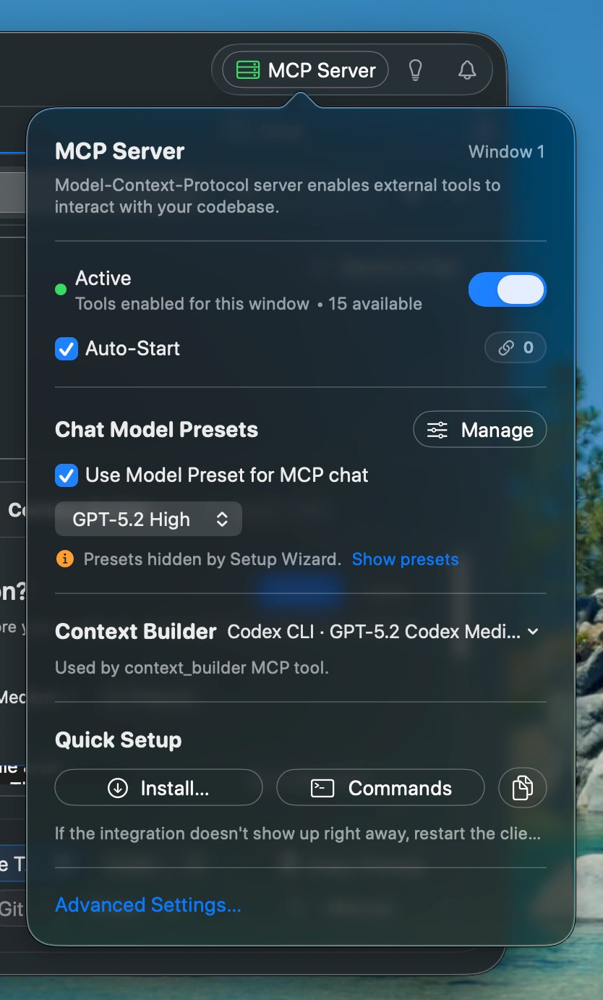

The MCP Server popover provides quick access to server configuration, model presets, and Context Builder settings. Access it via the MCP indicator in the toolbar.

## Popover Overview

Click the MCP indicator in the toolbar to open the settings popover. The indicator shows connection status and the number of available tools.



This is the primary location to configure the MCP server, including:

- **Server activation** - Enable/disable MCP tools for external clients
- **Chat Model Presets** - Choose which model handles MCP chat requests
- **Context Builder** - Select the agent that powers context discovery via MCP or CLI

## Server Controls

### Enable MCP Tools

The main toggle enables or disables MCP tools for the current window. When enabled, external clients can interact with your workspace through the MCP protocol.

### Auto-Start

When checked, the MCP server starts automatically when RepoPrompt launches. This is useful if you always want MCP available for your AI tools.

### Status Indicator

- **Green dot** - Server active with tools enabled
- **Orange dot** - Tools enabled but waiting for listener
- **Gray dot** - Inactive or tools disabled

## Chat Model Presets

Control which AI models are available to MCP clients when they use the `chat_send`and `list_models` tools.

### Use Model Preset for MCP Chat

When enabled, the `list_models` tool returns your configured Model Presets, allowing AI agents to select from your preferred model configurations. This gives agents access to different models for different tasks (e.g., fast models for simple queries, reasoning models for complex planning).

When disabled, `list_models` only returns the current default chat model.

### Fallback Model

If Model Presets are enabled but none are configured, MCP chat uses this fallback model. Choose a model with strong reasoning capabilities for planning-oriented workflows.

:::info

**Tip:** Configure Model Presets in Settings → Chat → Manage Presets to give AI agents a selection of models optimized for different task types.

:::

### How Agents Use Presets

When an AI agent calls `chat_send`, it can specify a `model` parameter that matches a preset ID or name. The agent can first call `list_models` to discover available presets and their descriptions, then choose the most appropriate one.

```text
// Agent discovers available models
list_models → returns preset IDs and descriptions

// Agent selects appropriate model for task
chat_send(message: "...", model: "FastChat")
```

## Context Builder Settings

Configure which agent powers the `context_builder` MCP tool, which helps AI agents build relevant file context for their tasks.

### Context Builder Agent

Select the agent type used when MCP clients invoke context discovery. Options include:

- **Codex** - OpenAI's Codex models, optimized for code understanding
- **Claude** - Anthropic's Claude models
- **Gemini** - Google's Gemini models

The selected agent determines which AI provider handles context-building requests. Choose based on your API availability and preferred model capabilities.

### How context\_builder Works

When an MCP client calls `context_builder` with task instructions, RepoPrompt's Context Builder agent:

1. Analyzes the task requirements
2. Explores the codebase to find relevant files
3. Builds an optimized selection within token limits
4. Returns the selection for subsequent operations

This enables AI agents to automatically gather context without manual file selection.

## Quick Setup

The popover includes buttons for quick installation in popular AI clients:

### Install MCP Server

Click "Install..." to automatically configure the MCP server in supported clients:

- **Cursor** - Adds to Cursor's MCP configuration
- **VS Code** - Configures the VS Code MCP extension
- **Codex CLI** - Sets up OpenAI's Codex CLI
- **Gemini CLI** - Configures Google's Gemini CLI
- **Claude Desktop** - Adds to Claude's MCP servers
- **Claude Code (per-project)** - Installs MCP config in the current workspace's `.claude/` folder

### CLI Installation (rp-cli)

Install the `rp-cli` command to `/usr/local/bin` for terminal access to RepoPrompt's MCP tools. This enables scripting, automation, and interactive exploration of your codebase from the command line.

```bash
# After installation, you can run commands like:
rp-cli tree                    # Show file tree
rp-cli search "TODO"           # Search codebase
rp-cli context --all           # Export full context
```

### claude-rp Wrapper

Install the `claude-rp` command - a wrapper for Claude Code that automatically configures it to use RepoPrompt's MCP tools instead of Claude's built-in file operations.

**Why use claude-rp?**

- **Frees up context:** RepoPrompt's codemaps and slices are more token-efficient than dumping entire files
- **No global MCP setup needed:** The wrapper configures everything automatically via command-line flags
- **Visual feedback:** See what Claude is doing in RepoPrompt's UI
- **Better file selection:** Use RepoPrompt's selection, slicing, and codemap features

```bash
# Instead of running:
claude

# Run:
claude-rp

# This automatically:
# - Points to RepoPrompt's MCP config
# - Enables strict MCP mode (ignores other configs)
# - Disables Claude's built-in Read, Write, Edit, Glob, Grep tools
```

:::info

**Prerequisite:** RepoPrompt must be running with MCP Server enabled for `claude-rp` to work.

:::

### Copy JSON

Copies the MCP server configuration to your clipboard for manual installation in any MCP-compatible client:

```json
{
  "mcpServers": {
    "RepoPrompt": {
      "command": "/path/to/repoprompt-mcp",
      "args": []
    }
  }
}
```

:::info

**Note:** After installing, restart the client application if the integration isn't detected immediately.

:::

## Advanced Settings

For additional configuration options, click "Open Status Dashboard" to access:

- Individual tool enablement
- Connection diagnostics and troubleshooting
- Active client management
- Multi-window configuration

See [Transport & Security](./mcp-transport.mdx) and [Connection Management](./mcp-connections.mdx) for details.
