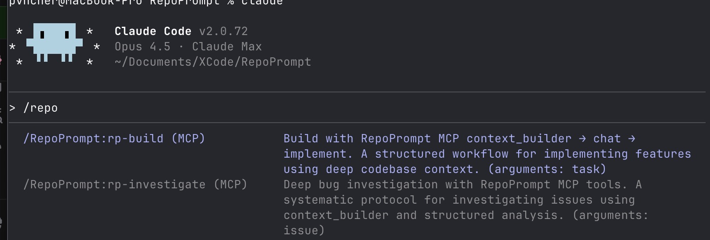
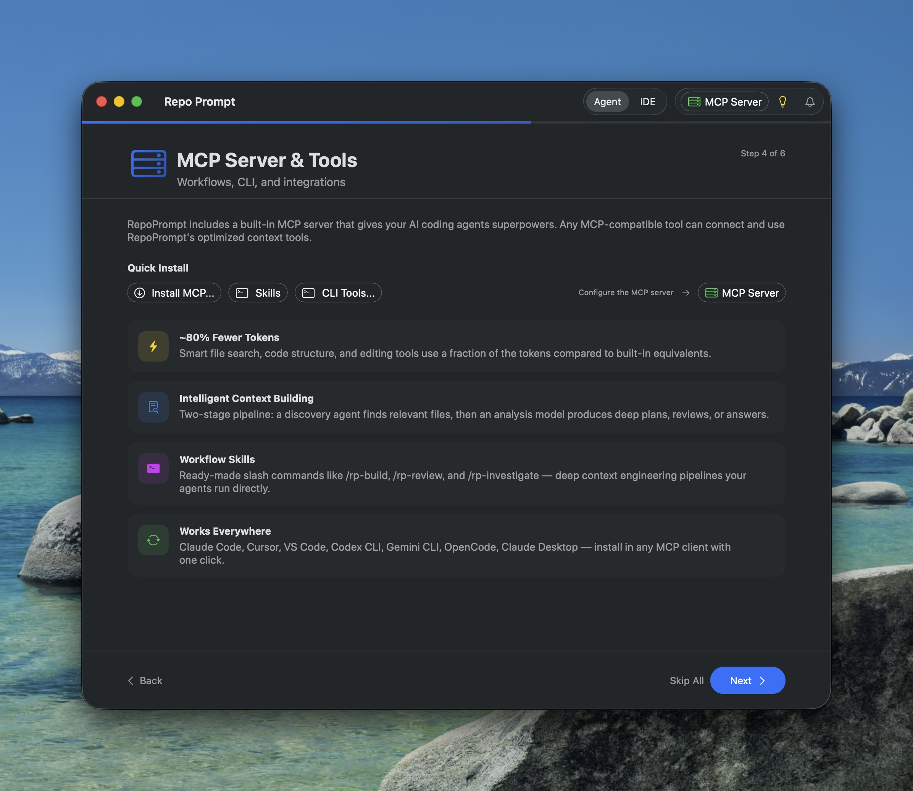

Once connected, your agent gains access to workflow commands that dramatically uplevel its capabilities. These guide the agent through a complete cycle: understand the task, use Context Builder to explore all relevant code, generate an informed plan, then implement the full solution — with minimal steering required from you.

Type `/repo` to see available commands like `/rp-build` for implementation workflows and `/rp-investigate` for deep bug investigation.

## How Workflow Commands Work

Each workflow command triggers a Context Builder pipeline through the MCP server. When an agent runs a command like `/rp-build`, here's what happens behind the scenes:

1. **Discovery Agent activates** — A specialized research model explores your entire codebase, following imports, references, and architectural patterns to find every relevant file
2. **Context is curated** — The discovery agent selects files within a token budget, using codemaps for reference files and full content for key files
3. **Analysis model reasons** — A powerful model receives the curated context and produces deep output — a plan, review, or investigation report
4. **Agent acts on the result** — Your agent receives the analysis and proceeds with implementation, fixes, or next steps

This separation means the agent gets architecturally-grounded guidance without spending its own context window on exploration. The agent stays focused on implementation while Context Builder handles the research.

## Available Commands

**/rp-build**

End-to-end implementation workflow. Context Builder gathers all relevant files and architectural patterns, the analysis model creates a detailed implementation plan, then the agent implements it directly. Best for new features and significant additions.

**/rp-review**

AI-powered code review. Publishes git diffs alongside full codebase context so the review model understands not just what changed, but the surrounding architecture. Catches issues that surface-level reviews miss.

**/rp-refactor**

Two-pass refactoring. First pass analyzes the codebase for improvement opportunities, second pass plans the implementation while preserving existing behavior. Great for cleaning up technical debt with confidence.

**/rp-investigate**

Systematic bug investigation. Context Builder explores the codebase to gather evidence, traces through code paths, and builds a root cause analysis. The agent keeps investigating until the issue is found.

**/rp-oracle-export**

Builds optimized codebase context for your task, then exports a prompt file you can paste directly into GPT Pro models on ChatGPT. Useful when you want a second opinion on a complex problem from a capable external model.

## Context Builder Response Types

The workflows above use the Context Builder's `context_builder` MCP tool with different response types. You can also invoke these directly for custom workflows:

- **clarify** — Build file context only, returns curated selection for manual use (default)
- **plan** — Generate an implementation plan grounded in your actual code patterns
- **question** — Answer a question about the codebase using deep context
- **review** — Generate a code review with git diff context and architectural understanding

## Git Integration

The `git` tool provides safe, token-efficient git operations for MCP agents: status, diff, log, show, blame, and snapshot management. Use it to understand repository state and review changes before committing.

For deep code reviews with full context mapping, see [Code Reviews & Git](../code-reviews/overview.mdx).

## Custom Skills

Beyond the built-in workflow commands, you can create your own skills — markdown prompt templates with YAML frontmatter that agents discover and run as slash commands. Skills let you codify your team's workflows and share them across projects.

Learn how to create and install custom skills in [Skills & Slash Commands](../../version-1.6.0/agent-mode/skills.mdx).

:::tip

**Getting Started:** After setting up the MCP connection, type `/repo` in Claude Code to see all available RepoPrompt commands. For more detail on each workflow and the Context Builder pipeline, see [Agent Mode Workflow Commands](../../version-1.6.0/agent-mode/workflows.mdx).

:::
