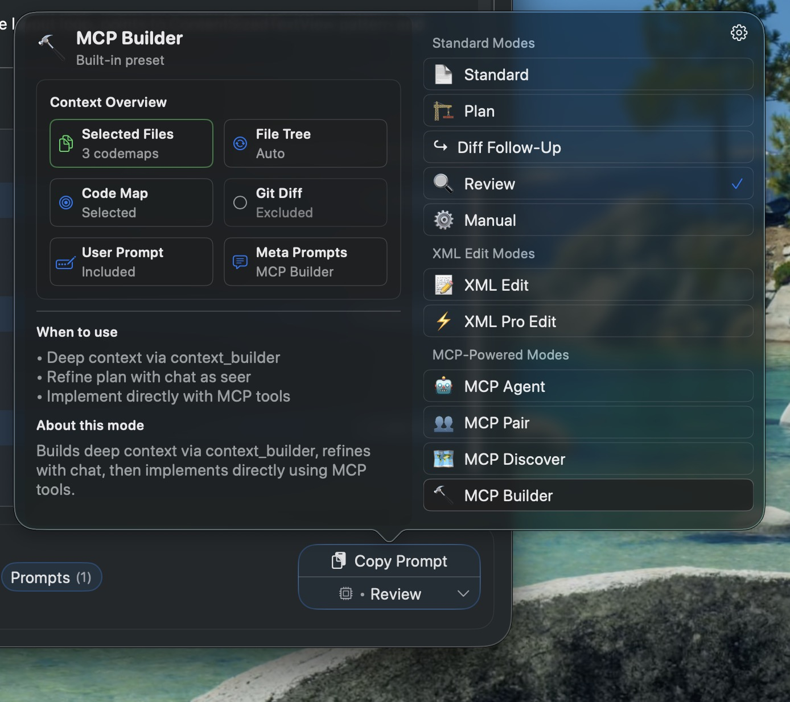

`/rp-build` is a structured Agent Mode workflow that automates the discovery→plan→implement pipeline. It uses [Context Builder](./discovery.mdx) to gather deep context, generates an architectural plan, then implements directly — all in a single agent session.

## How It Works

The workflow runs through four phases, each with a clear purpose:

### Phase 1: Quick Scan

The agent makes 2–3 tool calls max — typically `get_file_tree` and a few targeted searches — just enough to get oriented in the codebase. It reformulates your prompt with codebase-specific references (file paths, module names, API surfaces) so the next phase has grounded input to work with.

This phase is intentionally brief. The heavy lifting happens in Context Builder.

### Phase 2: Context Builder

The agent calls `context_builder` with `response_type: "plan"`. This is the core of the workflow — a sub-agent autonomously explores the codebase, selects the most relevant files, and generates an architectural plan grounded in actual code.

The plan includes which files to modify, what changes to make, and how they connect. The agent trusts this plan by default — it's produced by a model that has read the selected files in full, not just signatures.

### Phase 3: Oracle Clarification (Optional)

If navigating the selected code is difficult or the plan leaves a concrete gap, the agent can follow up with an oracle call to deep-reason over the selected files. This is *not* a default step — it only fires when there's an actual ambiguity to resolve.

Important: the oracle only sees files in the current selection. If coverage is wrong, the right move is to rerun Context Builder with refined instructions, not to manually curate the selection.

### Phase 4: Direct Implementation

The agent implements the plan using `apply_edits` and `file_actions` — creating, modifying, and moving files as needed. It works directly from the builder's plan without routing through an oracle edit mode.

## When to Use /rp-build vs /rp-orchestrate

| Workflow | How It Works | Best For |
| --- | --- | --- |
| `/rp-build` | Single-session pipeline: scan → plan → implement | Tasks that fit in one agent's scope — a feature, a refactor, a bug fix |
| `/rp-orchestrate` | Plans (or accepts a plan), decomposes into sub-tasks, delegates to multiple agents | Complex multi-part work that benefits from parallel execution across providers |

## Triggering

### 1. Slash Command (Primary)

Run `/rp-build <task>` in any Agent Mode session. The agent runs the full pipeline from scratch — quick scan, context building, planning, and implementation.

See [Workflow Commands](../mcp-server/workflow-commands.mdx) for more on slash commands.

### 2. Copy Preset (Secondary)

For Classic Edition IDE Mode users, the **MCP Builder** copy preset gives the agent a head start with pre-selected codemaps. This provides:

- **Project structure** — the file tree so the agent understands your codebase layout
- **Preselected files as codemaps** — token-efficient function signatures for files you've already identified
- **Task description** — your instructions from the compose area

Copy the preset and paste it into Claude Code or another MCP-connected agent. The agent uses your provided context to skip part of the quick scan, then proceeds through Context Builder and implementation as usual.

:::tip

**Key principle:** Don't skip Context Builder. Even when using the copy preset with pre-selected files, the builder does the heavy lifting — it reads the actual code, discovers dependencies you may have missed, and produces a plan grounded in what it found. The quick scan and preset just help it start in the right place.

:::
