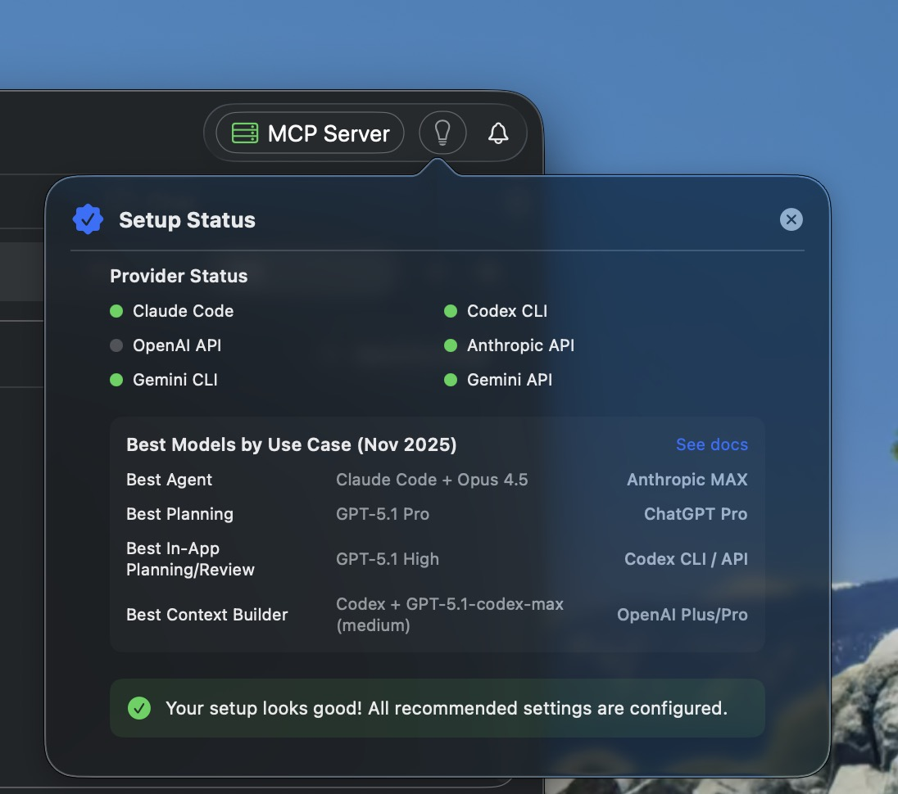

After extensive testing across workflows, here are the current go-to models for each use case as of May 2026. Repo Prompt includes an automatic model recommendation system that suggests optimal models based on your current workflow.

:::tip

**GPT-5.5 Update:** GPT-5.5 Low is our default for Explore and Context Builder/discovery via Codex CLI. GPT-5.5 Medium is now the default for Engineer/everyday implementation, while GPT-5.5 High remains the in-app choice for heavier planning, review, and pair sessions. Use GPT-5.5 Pro for ChatGPT Pro planning and exports. GPT-5.5 is not available as an OpenAI API or OpenRouter model.

:::

## Best Models by Use Case

| Use Case | Model | Access |
| --- | --- | --- |
| **Best Agent** | GPT-5.5 Medium | Codex CLI |
| **Best Planning Model** | GPT-5.5 Pro | ChatGPT Pro (web only) |
| **Best In-App Planning/Review** | GPT-5.5 High | Codex CLI |
| **Best Context Builder** | GPT-5.5 Low | Codex CLI |

## Why These Models?

### GPT-5.5 Low for Explore, Medium for Implementation

GPT-5.5 Low (available through Codex CLI) remains our top recommendation for explore and discovery work. GPT-5.5 Medium is the default for engineer agents and general implementation:

- Low keeps repeated codebase exploration and context building fast and efficient
- Medium adds reasoning headroom for everyday multi-step implementation
- Both remain more conversational and easier to steer than prior generations
- Use Medium as the default for most engineer implementation work

Claude Opus 4.6 is still useful as an optional secondary tool for editing-heavy tasks, but it is no longer something we think you need to keep on a separate $100 Max plan.

:::tip

**Codex-only:** GPT-5.5 is currently accessible only through Codex CLI. Do not try to configure it as an OpenAI API or OpenRouter model — those endpoints still serve the GPT-5.4 family.

:::

### GPT-5.5 Pro for Architectural Planning

GPT-5.5 Pro on ChatGPT Pro is our top planning recommendation because:

- Extended reasoning time produces thorough architectural analysis
- It handles large codebase planning extremely well
- It produces clearer architectural specs and follow-up plans
- It remains the best fit for high-value planning sessions

GPT-5.5 Pro is available only through the ChatGPT Pro web interface — use Repo Prompt's **ChatGPT Export** copy preset to hand it a curated prompt. It is not a Codex CLI or OpenAI API model.

### GPT-5.5 High for In-App Planning/Review

For in-app Chat planning and code review, we recommend Codex CLI with GPT-5.5 High:

- Strong reasoning without the wait times of ChatGPT Pro sessions
- Won't exhaust usage limits as quickly as Pro-style planning sessions
- XHigh is available for the hardest in-app problems
- High is the practical default for most Repo Prompt in-app sessions

### GPT-5.5 Low for Context Building

We recommend GPT-5.5 Low as the Context Builder and discovery default. It is the practical Codex CLI default for repeated exploration, file selection, and handoff preparation.

The Context Builder agent benefits from:

- Strong codebase understanding
- Efficient file exploration and selection
- Uses usage limits more slowly than GPT-5.5 Medium/High while staying on the current GPT-5.5 family
- Stays practical for repeated discovery runs while matching the current default recommendation

## Recommended Subscriptions

### Core Setup (Recommended)

| Plan | Historical price | Use |
| --- | --- | --- |
| **ChatGPT Pro** | $200/month | Codex CLI (GPT-5.5 Low for explore/discovery, GPT-5.5 Medium for engineer implementation, GPT-5.5 High for heavier work) + GPT-5.5 Pro for planning |

This setup gives you:

- Best-in-class explore/discovery with GPT-5.5 Low and engineer implementation with GPT-5.5 Medium via Codex CLI
- Best-in-class in-app planning/review with GPT-5.5 High via Codex CLI
- Best-in-class architectural planning with GPT-5.5 Pro on ChatGPT Pro web
- No need to add a separate premium Claude plan just to round out the workflow

### Optional Claude Add-On

| Plan | Historical price | Use |
| --- | --- | --- |
| **Claude Pro** | $20/month | Claude Code for light UI work, polish, and fast fixes when you want it |

If you still like Claude's editing style, we now recommend keeping it lightweight: Claude Pro is enough for light UI work and quick fixes. Upgrade beyond that only if Claude Code is a daily driver for you.

### Budget Setup (Great Results)

| Plan | Historical price | Use |
| --- | --- | --- |
| **ChatGPT Plus** | $20/month | Codex CLI + GPT-5.5 Low / GPT-5.5 Medium / GPT-5.5 High |
| **Total** | **$20/month** | Context Builder + solid in-app chat |

This gives you:

- Context Builder/explore with GPT-5.5 Low and default implementation with GPT-5.5 Medium
- Strong in-app planning and review with GPT-5.5 High via Codex CLI for heavier sessions
- Excellent results for most tasks without stacking subscriptions

That split is intentional: use GPT-5.5 Low for repeated context-building and explore work, GPT-5.5 Medium for engineer/default implementation, and save GPT-5.5 High for heavier planning/review or pair-agent sessions.

:::tip

**Keep Evolving:** Model recommendations change as new releases come out. Check back regularly or follow @repoprompt on X for the latest recommendations.

:::
